# Sentinel AI

**A pixel-art robotic duck that lives on your Linux desktop and audits its security posture, with evidence for every claim it makes.**

Sentinel AI is a Linux-native security companion for Linux Mint Cinnamon (X11), written in Python with PySide6. It runs read-only checks against the machine it lives on and turns the results into a duck that reacts, desktop notifications, a findings dashboard and audit-grade evidence reports. It never reports a control as passing unless it can show the evidence.

<p align="center">
  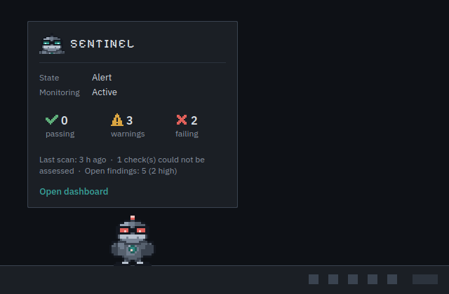<br>
  <sub>A composited mock-up of the duck and its status popup (not a screenshot of a real desktop). All images in this README come from a made-up sample host; see <a href="#about-the-images">About the images</a>.</sub>
</p>

<p align="center">
  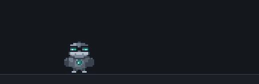
  &nbsp;
  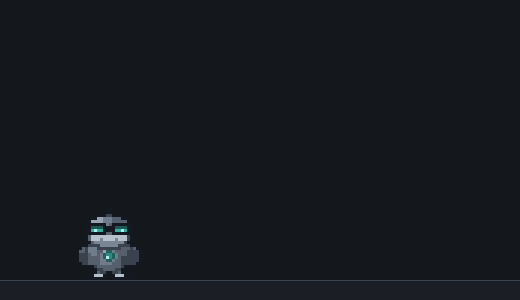
</p>

<p align="center"><sub>Left: idle wandering along the floor. Right: being picked up, carried, dropped, and landing under gravity. Both animations are rendered by the real sprite, wanderer and physics code (<code>tools/make_docs_assets.py</code>).</sub></p>

---

## Contents

1. [At a glance](#at-a-glance)
2. [Why this exists, and the principles behind it](#why-this-exists-and-the-principles-behind-it)
3. [Tour](#tour)
   - [The companion](#the-companion)
   - [Living on the desktop](#living-on-the-desktop)
   - [Pick it up, throw it, watch it fall](#pick-it-up-throw-it-watch-it-fall)
   - [The dashboard](#the-dashboard)
   - [Audit evidence reports](#audit-evidence-reports)
   - [The command line](#the-command-line)
4. [The security checks](#the-security-checks)
5. [Architecture](#architecture)
6. [Engineering notes](#engineering-notes)
7. [Security model](#security-model)
8. [Deliberately no AI](#deliberately-no-ai)
9. [Design system](#design-system)
10. [Install and run](#install-and-run)
11. [Development](#development)
12. [Limitations](#limitations)
13. [Status](#status)
14. [Credits and licences](#credits-and-licences)

---

## At a glance

| | |
|---|---|
| **What it is** | A desktop companion (a duck) plus a security assessment engine, dashboard and report exporter |
| **Platform** | Linux Mint Cinnamon on X11, Python 3.11+, PySide6 |
| **Checks** | Six read-only controls: host firewall, SSH exposure, SSH hardening, failed logins, security updates, exposed network ports |
| **Core guarantee** | A `PASS` cannot be constructed without evidence. Unreadable evidence is `UNKNOWN`, never a pass |
| **Privilege** | Runs as the logged-in user. No root, no background service, never changes the system |
| **Output** | The duck's state, desktop notifications, a dashboard, a SQLite evidence trail, and self-contained HTML or JSON reports |
| **AI** | None, by decision. Every sentence the app produces comes from a deterministic check ([why](#deliberately-no-ai)) |
| **Runtime dependency** | One: `PySide6-Essentials` |
| **Tests** | 624 automated tests across 18 files (at the time of writing); key behaviours were mutation-checked by breaking the code and watching the tests fail |
| **Size** | About 5,400 lines of source in 41 modules, plus about 3,600 lines of tests |

---

## Why this exists, and the principles behind it

Most "security dashboards" are happy to show a green tick. A tick is a claim, and a claim with no evidence behind it is worse than no claim. The idea behind Sentinel AI is to build a small security tool whose first design constraint is **honesty**, then give it a personality so that people actually leave it running.

The principles, each of which is enforced in code rather than left as a guideline:

1. **Evidence, or it did not happen.** Every assessment carries the observations it rests on (which file or command, and what was seen). The `Assessment` type refuses to exist as a `PASS` with no evidence.
2. **Unknown is not pass.** If a file is unreadable, a binary is missing or the data is stale, the result is `UNKNOWN`. A check that crashes becomes `ERROR`. Neither can ever close a finding.
3. **Conflicting evidence is reported as a conflict.** The firewall check treats `ufw.conf` as authoritative when the service says "active" but the configuration says `ENABLED=no` (more [below](#worked-example-when-the-service-lies)).
4. **Read-only and unprivileged.** Checks cannot touch the system: they receive a `Reader` abstraction instead of calling `open()` or `subprocess` themselves. Remediation is text for a person; Sentinel never applies it.
5. **React to what changed, not to what exists.** An already-known finding does not make the duck alarm every hour.
6. **No fabricated data.** With no scan yet, the UI says "No assessment yet". There are no placeholder alerts and no invented numbers.
7. **Untrusted text stays text.** Evidence can contain attacker-controlled strings (a failed SSH login for the user name `` lands in the auth log). Nothing from a scan is ever interpreted as markup.

---

## Tour

### The companion

The duck is a state machine, not an animation loop. Its state is a pure function of what it is doing and how long it has been doing it, so every animation is deterministic and testable.

<p align="center">
  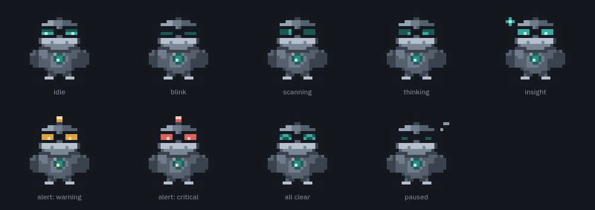
</p>

| State | When | What you see |
|---|---|---|
| Idle | Nothing happening | Subtle breathing and a blink every six seconds |
| Scanning | A scan is running | A light sweeps across the goggle lenses |
| Alert (amber) | A new medium-severity issue | Lenses and chest core turn amber, the beacon lights |
| Alert (red) | A new confirmed high-severity failure | The same, in red. Only a `FAIL` at high severity or above goes red |
| Insight | A new low-severity finding | A sparkle appears |
| Happy | A scan where everything passes | "^ ^" eyes and a small bounce |
| Sleeping | Monitoring is paused | Closed eyes and drifting "z" marks |

Transient states (alert, insight, happy) have priorities and always return to the state that was underneath them; a critical alert can upgrade a warning alert that is already playing. With reduced motion (set in config, or following Cinnamon's animation setting) every state becomes one static frame, so state stays readable without movement.

### Living on the desktop

The duck sits above the desktop background and below normal windows, off the taskbar and on every workspace, which took some work on Cinnamon (see [Engineering notes](#engineering-notes)). Single click opens a compact status popup, double click opens the dashboard, right click opens the menu, and the tray icon offers the same actions plus pause and quit.

<p align="center">
  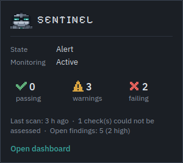
</p>

While idle it wanders along the bottom edge of the work area: it stands for a few seconds, strolls, stops at the screen edges, turns to face you, and heads back. The wanderer is a separate seeded, Qt-free class that moves one sprite cell per tick, so the walk never leaves the pixel grid, and it holds still whenever anything else has the duck's attention (an alert, a click, reduced motion).

### Pick it up, throw it, watch it fall

Drag the duck and it hangs from the pointer: lifted, wide-eyed, wings flapping, legs trailing the way you drag. Let go above the floor and it is thrown with your pointer's velocity, falls under gravity, bounces off the screen sides, and lands; a hard landing squashes it, a short hop does not. You can catch it mid-air.

<p align="center">
  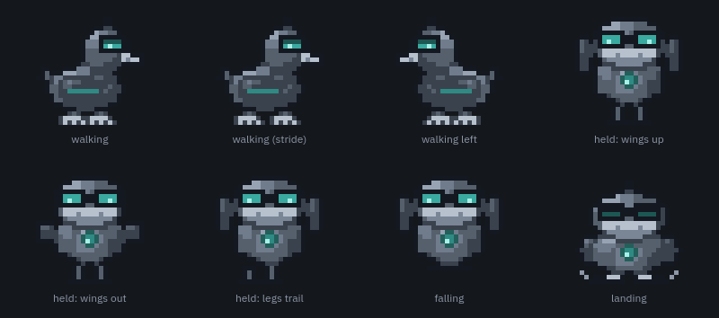
</p>

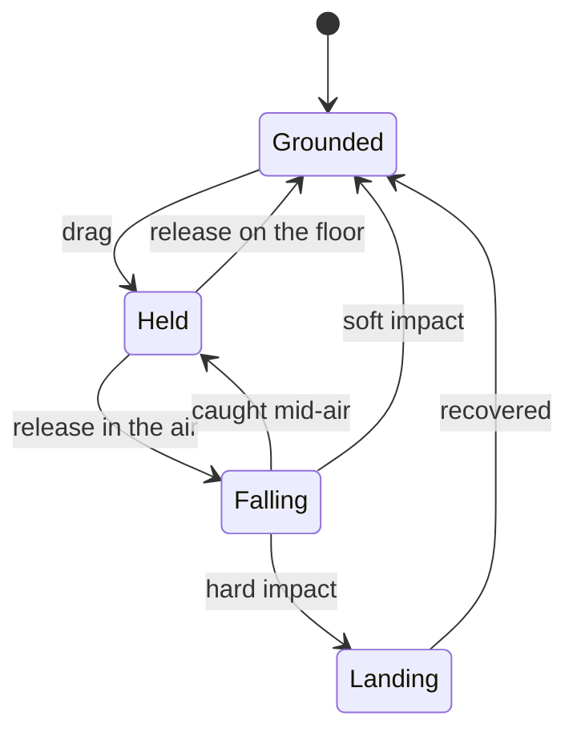

The physics is a small Qt-free rigid body that takes every time and position as an argument, so it is deterministic and tested without a display or a clock. Falling uses exact constant-gravity kinematics:

```python
# companion/physics.py
self.vy = min(prev_vy + GRAVITY * dt, TERMINAL_SPEED)
# Average velocity over the step: exact for constant gravity (using the end-of-step
# velocity overstates the distance by a large fraction on a short fall).
self.y += 0.5 * (prev_vy + self.vy) * dt
...
# Speed at the moment of contact from v^2 = v0^2 + 2 g d (exact for constant gravity)
drop = w.floor_y - prev_y
self.impact = min(math.sqrt(prev_vy * prev_vy + 2 * GRAVITY * drop), TERMINAL_SPEED)
```

| Parameter | Value |
|---|---|
| Gravity / terminal speed | 3200 px/s² / 2600 px/s |
| Throw velocity | Estimated from the last 100 ms of pointer movement, capped at 2200 px/s; zero if the pointer had stopped |
| Walls | Absorb 65% of the horizontal speed |
| Squash | Only for impacts of 500 px/s or more |
| Clocks | An 8 Hz behaviour tick, and a 60 Hz physics timer that runs **only** while the duck is held or airborne, so a standing duck costs almost nothing |
| Reduced motion | No fall: letting go stands the duck on the floor |

### The dashboard

One sentence leads and says the worst thing first. Under it is a row of stat tiles, then the controls sorted worst-first beside the detail for the selected one: what was found, the evidence in a monospaced block, the recommended action, the framework reference, and the finding's history.

<p align="center">
  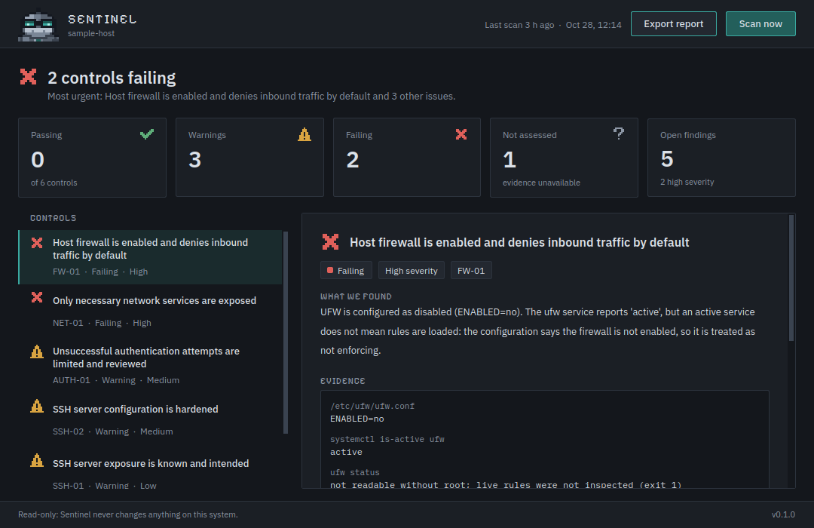<br>
  <sub>The misconfigured sample host. The service reports "active" but the configuration says the firewall is disabled, and the dashboard shows both pieces of evidence.</sub>
</p>

Status is never colour alone: each result has its own pixel-art icon shape and a word. The "not assessed" state is shown as such, not folded into green.

<p align="center">
  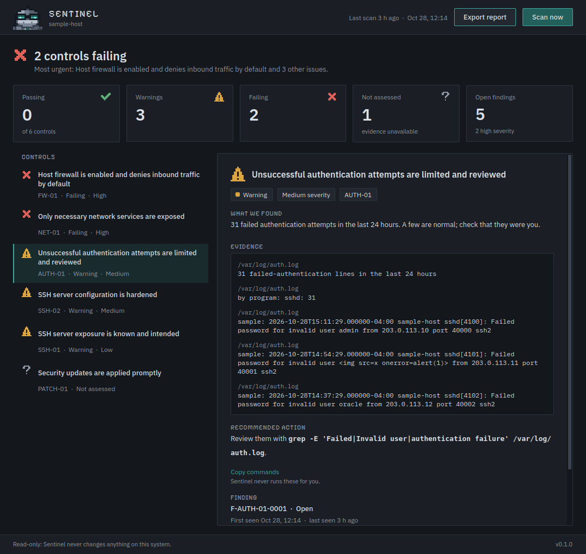<br>
  <sub>Evidence is shown verbatim as plain text. The second sample line has the user name <code>&lt;img src=x onerror=alert(1)&gt;</code>, which is displayed literally and never interpreted.</sub>
</p>

<p align="center">
  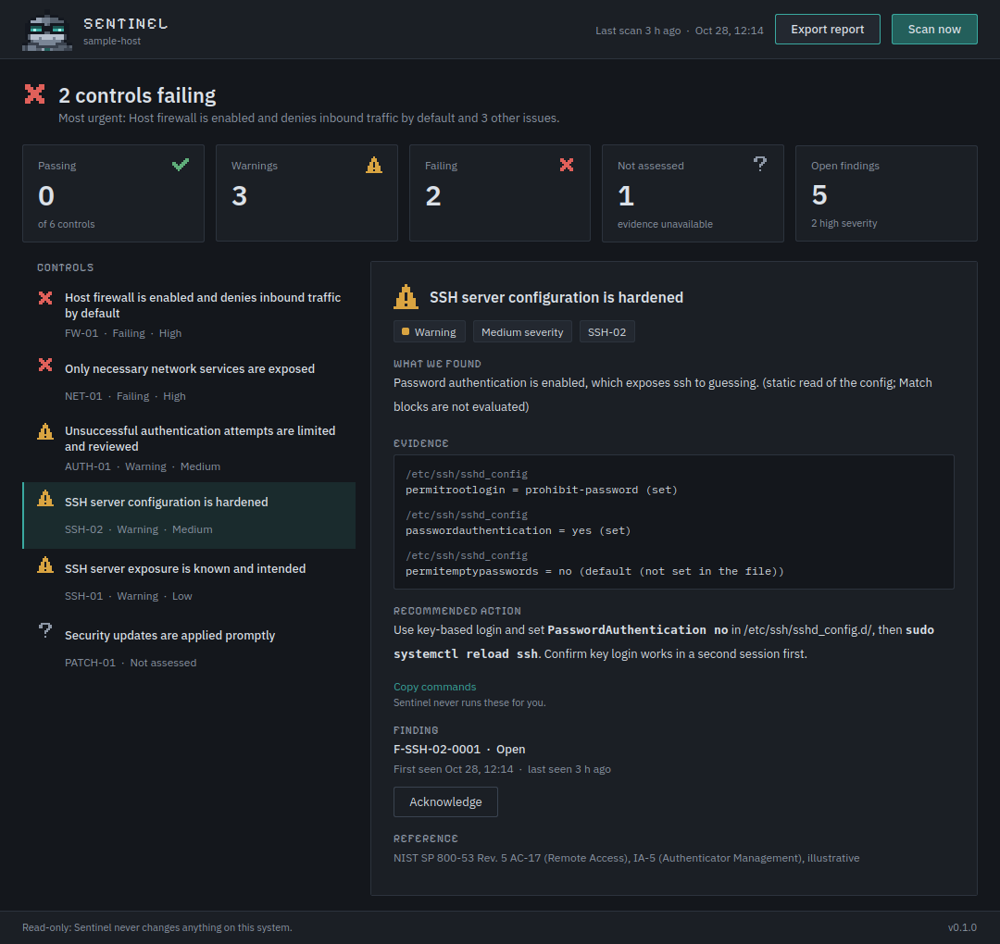<br>
  <sub>Recommendations can be copied but are never run: "Sentinel never runs these for you."</sub>
</p>

After the sample host is hardened and rescanned, the findings resolve on their own because the *evidence* changed, not because someone clicked a button:

<p align="center">
  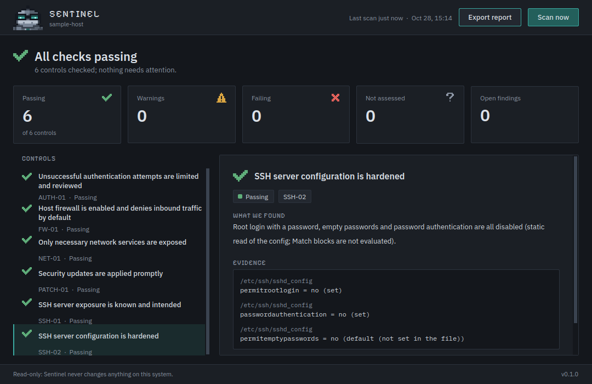
</p>

With nothing scanned yet the dashboard says so and offers one call to action:

<p align="center">
  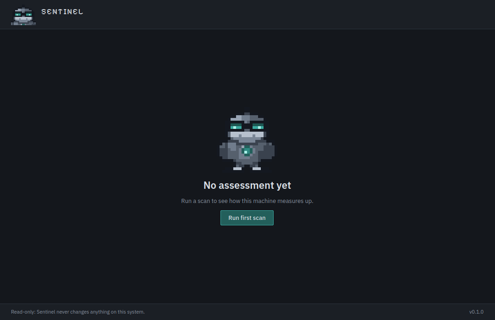
</p>

A finding has a lifecycle, driven purely by evidence:

* A `FAIL` or `WARNING` opens a finding, or refreshes the existing open one.
* A `PASS` resolves an open or acknowledged finding. Evidence beats acknowledgement.
* `UNKNOWN` and `ERROR` change nothing. A check that could not run must never close a finding.
* A severity increase is reported as an escalation and reopens an acknowledged finding.

### Audit evidence reports

Every scan can be exported as a self-contained HTML page or as JSON. A report contains every control (passes included, because an auditor wants proof that something was checked), the evidence behind each result, the recommendation, the finding history, and a content checksum.

<p align="center">
  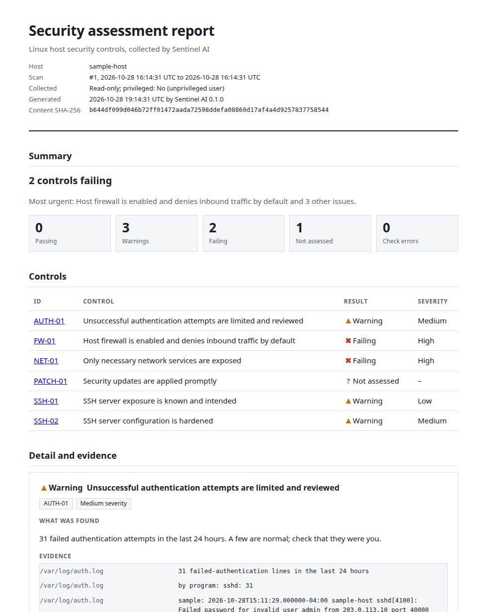
</p>

<p align="center">
  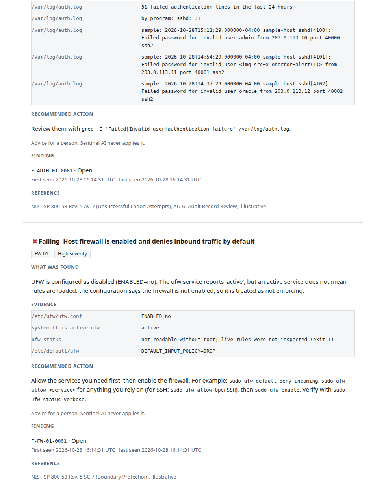
</p>

<p align="center">
  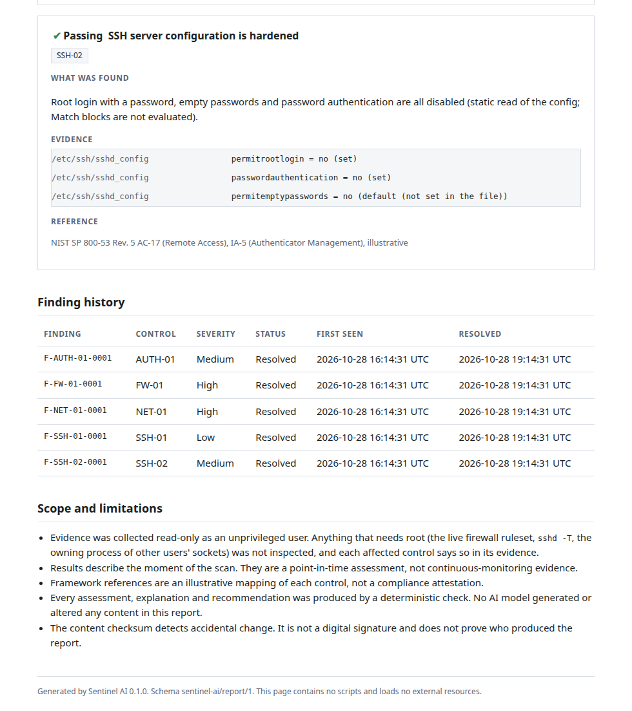<br>
  <sub>The "after" report: five findings, each first seen three hours earlier and now resolved, followed by an explicit scope-and-limitations section.</sub>
</p>

The HTML is one file with no scripts, no external resources and a `Content-Security-Policy` of `default-src 'none'`. It prints cleanly and works offline. Open the real sample files in this repository: [`docs/sample/sample-report-before.html`](docs/sample/sample-report-before.html), [`docs/sample/sample-report-after.html`](docs/sample/sample-report-after.html) and their JSON twins. An excerpt of the JSON:

```json
{
  "schema": "sentinel-ai/report/1",
  "host": { "id": "sample-host" },
  "scan": { "scan_id": 1, "read_only": true, "privileged": false },
  "summary": {
    "headline": "2 controls failing",
    "counts": { "pass": 0, "fail": 2, "warning": 3, "unknown": 1, "error": 0 }
  },
  "controls": [
    {
      "control_id": "FW-01",
      "result": "fail",
      "severity": "high",
      "explanation": "UFW is configured as disabled (ENABLED=no). The ufw service reports 'active', but an active service does not mean rules are loaded: ...",
      "evidence": [
        { "source": "/etc/ufw/ufw.conf", "observation": "ENABLED=no" },
        { "source": "systemctl is-active ufw", "observation": "active" }
      ]
    }
  ],
  "integrity": {
    "algorithm": "sha256",
    "covers": "host, scan, controls and findings (not the export time)"
  }
}
```

The checksum excludes the export time, so exporting the same scan twice gives the same hash, and `verify_integrity()` recomputes it. It detects accidental change. It is **not** a digital signature, and the report says so. Full format and guarantees: [`docs/REPORTS.md`](docs/REPORTS.md).

### The command line

No GUI is needed for any of this:

```console
$ sentinel-ai --scan
Sentinel AI assessment, scan #1
Host sample-host; finished 2026-10-28T16:10:27Z
Read-only: nothing on this system was changed.

pass: 0  fail: 2  warning: 3  unknown: 1  error: 0

[FAIL] FW-01  Host firewall is enabled and denies inbound traffic by default
       UFW is configured as disabled (ENABLED=no). The ufw service reports 'active', but an
       active service does not mean rules are loaded: ... so it is treated as not enforcing.
       evidence: /etc/ufw/ufw.conf: ENABLED=no
       evidence: systemctl is-active ufw: active
       evidence: ufw status: not readable without root; live rules were not inspected (exit 1)
       evidence: /etc/default/ufw: DEFAULT_INPUT_POLICY=DROP
       recommended: Allow the services you need first, then enable the firewall. ...

$ sentinel-ai --scan --export report.html     # scan now, then save an audit report
$ sentinel-ai --export report.json            # export the latest stored scan
```

Exit codes for `--export`: `0` saved, `1` could not write the file, `2` bad arguments or nothing scanned yet. The format comes from the file extension; an unknown extension is refused rather than guessed. Files are written atomically with owner-only permissions (`0600`).

---

## The security checks

Six read-only checks, each mapped (illustratively) to a NIST SP 800-53 control family. The mapping is a navigation aid, not a compliance claim, and the report says so.

| Control | Question | Reads | Result logic |
|---|---|---|---|
| **FW-01** (SC-7) | Is a host firewall enabled and denying inbound by default? | `/etc/ufw/ufw.conf`, `systemctl is-active ufw`, `/etc/default/ufw`, `ufw status` | Config is authoritative. Service "active" with `ENABLED=no` is a `FAIL`. `PASS` needs config enabled, service active and a deny-by-default policy |
| **SSH-01** (CM-7, AC-17) | Is an SSH server exposed? | sshd files, `systemctl is-active ssh ssh.socket`, `ss -tlnH` | Not installed is a `PASS`; running is a `WARNING`; socket activation counts as running |
| **SSH-02** (AC-17, IA-5) | Is the SSH server hardened? | `sshd_config` and its `Include`s | Static parse: first value wins, stops at `Match`, include depth capped. Root login or empty passwords is a `FAIL`; password authentication a `WARNING` |
| **AUTH-01** (AC-7, AU-6) | Are failed logins rare? | `/var/log/auth.log`, else `journalctl` | 24-hour window. Below 5 pass, 5 to 99 warning, 100 or more fail. ISO and classic syslog timestamps both parsed |
| **PATCH-01** (SI-2) | Are security updates pending? | `/var/lib/update-notifier/updates-available` | The file omits the security line when there are none, so a stated total with no security line means zero. Data older than 7 days is `UNKNOWN` |
| **NET-01** (CM-7, SC-7) | Which services accept outside connections? | `ss -tulnHp` | Wildcard or non-loopback TCP listeners warn; a known-dangerous service (databases, RDP, VNC, SMB, Telnet) is a `FAIL`; UDP is listed but not judged |

### The result type

```python
# monitoring/model.py
@dataclass(frozen=True)
class Assessment:
    check_id: str
    control: Control
    result: Result  # PASS | FAIL | WARNING | UNKNOWN | ERROR
    severity: Severity
    explanation: str
    evidence: tuple[Evidence, ...]
    remediation: str | None = None  # advice for a human; Sentinel never applies it

    def __post_init__(self) -> None:
        # The invariant the whole product rests on: no evidence, no PASS.
        if self.result is Result.PASS and not self.evidence:
            raise ValueError(f"{self.check_id}: a PASS needs at least one piece of evidence")
```

`Evidence` holds only *observations* (a file or command, and what was seen). The interpretation (explanation, severity, recommendation) lives on the assessment, so the facts under a conclusion can never be edited by it.

### Worked example: when the service lies

On the development machine this project was built on, `systemctl is-active ufw` said **active** while `/etc/ufw/ufw.conf` said **`ENABLED=no`**. A check that trusts the service state would have reported a working firewall. This one does not:

```python
# monitoring/checks/firewall.py
if enabled != "yes":
    conflict = (
        " The ufw service reports 'active', but an active service does not mean rules are "
        "loaded: the configuration says the firewall is not enabled, so it is treated as "
        "not enforcing."
        if service == "active"
        else ""
    )
    return _result(
        Result.FAIL,
        Severity.HIGH,
        f"UFW is configured as disabled (ENABLED={enabled or 'not set'}).{conflict}",
        ev,
        ENABLE_ADVICE,
    )
```

And when everything checks out but the live rules need root to read, the `PASS` says what it did *not* verify: "The live ruleset requires root and was not inspected, so this confirms the firewall's configured state, not the individual rules."

### How a scan drives the duck

| Scan outcome | Duck | Notification |
|---|---|---|
| New or escalated `FAIL` at high severity or above | Alert, red | Yes |
| New or escalated medium issue | Alert, amber | Yes |
| New low issue | Insight | Yes |
| Nothing new, findings still open | Settles to idle | No |
| Everything passes, nothing open | Happy | No |
| Only `UNKNOWN` or `ERROR` | Settles to idle | No |

Notifications are capped at three per scan plus a summary line, are never sent while monitoring is paused, and can be disabled. Full detail on each control, the severity rubric and the finding lifecycle: [`docs/CHECKS.md`](docs/CHECKS.md).

---

## Architecture

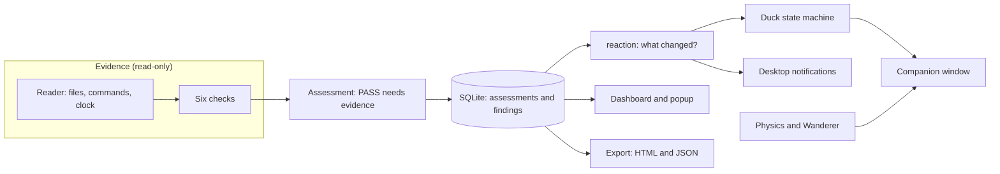

```text
src/sentinel_ai/
  app.py                 wiring: companion + tray + panels, single-instance lock, CLI
  config.py              Config dataclass, XDG paths, tolerant JSON load, atomic save
  companion/
    state_machine.py     Qt-free behaviour: states, tones, priorities, pause
    roaming.py           Wanderer: seeded stand / walk / turn behaviour along the floor
    physics.py           Qt-free rigid body: held, thrown, falling, landing
    pixelart.py          shaded-ellipse and outline toolkit used to build the sprite
    sprites.py           front and side pixel data, pose frames, frame table
    animations.py        pure (state, ticks, walk, pose) -> frame and offset
    render.py            sprite grid -> scaled QPixmap, tray icon
    window.py            frameless draggable window, two clocks, X11 hook
  monitoring/
    model.py             Result, Severity, Evidence, Assessment, Finding
    reader.py            the only door to the system: read-only Reader + LocalReader
    checks/              firewall, ssh, auth, updates, ports, and the registry
    scanner.py           runs every check; a crash becomes ERROR, never a PASS
    store.py             SQLite: assessments (audit trail) and findings (lifecycle)
    reaction.py          pure: scan result -> duck state, tone, notifications
    summary.py           labels, worst-first order, the lead sentence
    export.py            audit evidence reports (one dict, two renderers)
    monitor.py           Qt: scans on a worker thread and on a schedule
  platform/              X11 desktop-layer adapter, reduced-motion resolution
  ui/                    design tokens, fonts, icons, dashboard, status popup
```

Design decisions worth knowing:

* **Logic is separated from Qt.** The state machine, physics, wanderer, sprite data, checks, store, reaction mapping and export import no Qt, so they are tested without a display. Qt behaviour (drag, click disambiguation, repaint-on-change) is tested on the `offscreen` platform.
* **Checks cannot touch the system.** They receive a `Reader` (files, a glob, a command, the clock). That keeps them read-only by construction and lets tests feed them missing files, permission errors and conflicting sources.
* **Behaviour is a function of ticks, not wall-clock time.** Animations are pure functions of `(state, ticks)`, and the widget repaints only when the visible frame changes.
* **The window's bottom edge is the ground.** The sprite canvas pads left, right and top but not below the feet, and animation offsets only ever move the sprite sideways or up. Cinnamon refuses to let a window overlap the panel, so padding under the feet would be pushed up and leave the duck floating.
* **Scans run on a worker thread**, each with its own SQLite connection, and results return to the UI thread as signals.
* **Qt objects are released before the `QApplication`.** Pixmap caches, widgets and the worker pool are cleared on shutdown, because a pixmap destroyed after the application crashes the process.

More in [`docs/ARCHITECTURE.md`](docs/ARCHITECTURE.md).

---

## Engineering notes

### Testing

624 tests, in layers: pure unit tests for everything Qt-free (including seeded property-style tests, such as "the wanderer never leaves its bounds across thousands of ticks and many seeds"), offscreen Qt tests that drive the real window with synthetic mouse events, a test that launches the genuine `main()` in a child process and quits it, and tests that parse the generated HTML back to prove hostile input never becomes a tag or an event handler.

**Mutation checking.** A passing test proves little if it cannot fail. For the behaviours that matter, I deliberately broke the code (removed the clamp, inverted the direction, dropped the escaping, ignored the floor) and checked that a test failed. That process found real weaknesses in tests I had already written, for example a "restrictive security policy" test that would have passed with an inert tag.

### Bugs found by actually running it

Several of these were invisible to unit tests and showed up only on a real desktop or a real X server:

| Bug | How it surfaced | Fix and guard |
|---|---|---|
| `wmctrl -b` silently ignores everything after its second property, so the "all workspaces" state was never applied | A live run showed the state missing; a screenshot of the duck on another workspace proved it | Requests are split into two calls; a test asserts no call carries more than two properties |
| A log call passing `extra={"message": ...}` raised `KeyError` (the key is reserved by `LogRecord`) and crashed the placement callback | First live launch | Renamed the key; regression test |
| Cinnamon refuses to let a window overlap the panel, so a padding cell under the feet floated the duck above the panel | Measured the window geometry against the work area | Removed the bottom padding; the window's bottom edge is the ground |
| A `font-size` in the application stylesheet silently overrides every `QFont` set in code, disabling the whole type scale | Rendered the dashboard and looked at it | Fonts are set in code only; a test checks the figure, wordmark and evidence fonts at runtime |
| Popup counts clipped ("4 passi", "1 failin") | A capture of the real popup; offscreen layout hid it | Restructured the layout; a clipping test at the fixed width |
| The test process crashed at interpreter exit in 8 of 9 runs, after every test passed (Qt pixmaps destroyed after the `QApplication`) | Running the suite repeatedly | Deterministic teardown in the app and the test session; a child-process test of the real quit path |
| Falling used semi-implicit Euler, which overstated short falls by up to 13% at coarse time steps | A failing analytic-accuracy test | Exact constant-gravity kinematics; the error is now 0.000% at every step size tested |
| Tests that exercised failure paths wrote their tracebacks into the user's real log file | Reading the real log | An autouse fixture isolates every XDG directory; a test proves the real log is untouched by a full run |

---

## Security model

| Concern | How it is handled |
|---|---|
| Untrusted text in evidence (usernames, log lines) | Qt labels show evidence as plain text; any rich text goes through `escape()`; HTML reports escape every field and ship a `Content-Security-Policy`. Tests feed hostile strings to every field and parse the output |
| Privilege | Runs as the logged-in user. Never calls `sudo`, never starts a privileged service. Where root would be needed, the evidence says so and the result is capped accordingly |
| Writes to the system | None. Checks receive a read-only `Reader`; commands use fixed argument lists (no shell) with timeouts and a fixed locale |
| Report files | Atomic write, owner-only (`0600`), because evidence can name users and addresses |
| Identity | The host is a hostname plus a short hash of the machine-id. The raw machine-id is never stored or logged |
| Network | The app makes no network connections of its own. Fonts are bundled; notifications use the local session bus |
| Dependencies | One runtime dependency (`PySide6-Essentials`) |
| Second instance | A lock file prevents two copies running |

---

## Deliberately no AI

The product is called Sentinel *AI*, and it contains no AI model. That is a design decision, not a gap. In an audit tool, an invented finding or a confidently wrong explanation is worse than a plain, correct one, and the local language models available while building this were prone to exactly that. So every assessment, explanation and recommendation is written by the deterministic check that collected the evidence, the exported reports state that no AI generated or altered any content, and the type system keeps observations separate from interpretation so that the facts beneath a conclusion cannot be changed by it. A model could later be added as a clearly labelled, optional reader that cannot alter evidence; the seam exists, and nothing depends on it.

---

## Design system

One source of truth, [`src/sentinel_ai/ui/theme.py`](src/sentinel_ai/ui/theme.py). Charcoal and slate surfaces, a muted turquoise accent reserved for the brand and interaction, and a *separate*, reserved status scale that is never used decoratively.

<p align="center">
  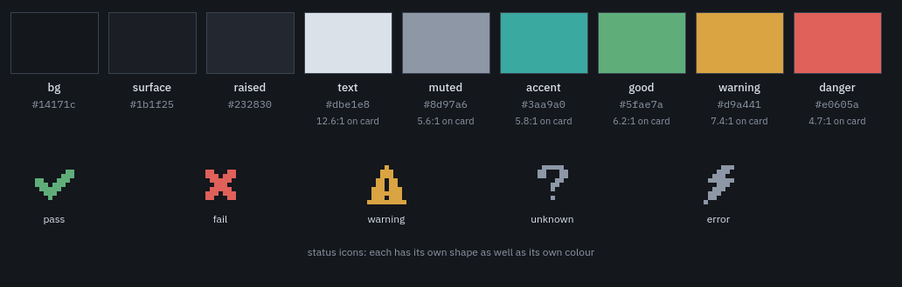
</p>

* **Contrast is measured, not eyeballed.** The ratios in the image are computed by the generator script (WCAG 2) against the card surface. The weakest text case, muted ink on the hover surface, is 4.56:1. Status colours only ever fill marks (an icon, a square), never text.
* **Never colour alone.** Each status has its own pixel-art icon *shape* and a word.
* **Type.** IBM Plex Sans for text and every number, IBM Plex Mono for evidence, and Pixelify Sans only for the wordmark and small section labels, where its pixel grid echoes the duck. Fonts are bundled and set in code, never in the stylesheet.
* **Sprites are generated, not drawn pixel by pixel.** Shaded ellipses with one light direction and a four-step slate ramp give consistent, clean curves; details are placed on top. A single dark outline wraps the whole silhouette, and golden-outline tests guard the character's identity.
* **Spacing and shape.** A 4 px grid and a 2 px corner radius: nearly square, which sits better beside pixel art than soft rounding.

Details and the full token tables: [`docs/DESIGN_SYSTEM.md`](docs/DESIGN_SYSTEM.md).

---

## Install and run

Requirements: Linux Mint Cinnamon on X11, Python 3.11 or newer. `wmctrl` is optional but recommended (it is how the duck is kept on every workspace); without it the app still runs, using Qt window hints only, and logs that.

```bash
git clone <this repository> sentinel-ai && cd sentinel-ai
python3 -m venv .venv
.venv/bin/pip install -e '.[dev]'
sudo apt install wmctrl          # optional

.venv/bin/sentinel-ai            # start the companion
.venv/bin/sentinel-ai --scan     # one read-only assessment, printed, no GUI
```

Only one instance runs at a time. Closing the dashboard never stops monitoring; use the tray or right-click menu to quit.

**Start at login** (the 5 second delay lets the panel's tray come up first):

```bash
mkdir -p ~/.local/share/applications ~/.config/autostart ~/.local/share/icons/hicolor/128x128/apps
EXEC="$(pwd)/.venv/bin/sentinel-ai"
sed "s|^Exec=.*|Exec=$EXEC|" packaging/sentinel-ai.desktop > ~/.local/share/applications/sentinel-ai.desktop
{ cat ~/.local/share/applications/sentinel-ai.desktop; echo "X-GNOME-Autostart-Delay=5"; } \
  > ~/.config/autostart/sentinel-ai.desktop
cp packaging/sentinel-ai.png ~/.local/share/icons/hicolor/128x128/apps/
```

**Configuration** lives in `~/.config/sentinel-ai/config.json` and is read tolerantly: wrong types are ignored, and a corrupt file is set aside and defaults used.

| Key | Default | Meaning |
|---|---|---|
| `scan_interval_minutes` | `60` | Automatic scans; `0` means only when asked; otherwise at least 5 |
| `notifications` | `true` | Desktop notifications for new findings |
| `roam` | `true` | Wander along the floor while idle |
| `reduced_motion` | follows the desktop | `true` or `false` to force it |
| `scale` | `3` | Integer pixel scale of the sprite (2 to 8) |
| `companion_x` | unset | Last horizontal position (the floor is always the bottom edge) |

`SENTINEL_REDUCED_MOTION=1` also forces reduced motion. Data locations follow the XDG spec: findings in `~/.local/share/sentinel-ai/sentinel.db`, logs (JSON lines) in `~/.local/state/sentinel-ai/sentinel.log`.

---

## Development

```bash
.venv/bin/python -m pytest                       # 624 tests; the Qt ones run offscreen
.venv/bin/ruff check . && .venv/bin/ruff format --check .

# Regenerate every image and the sample reports used in this README:
QT_QPA_PLATFORM=offscreen .venv/bin/python tools/make_docs_assets.py
```

The tests never touch a real desktop and never read or write your real config, data or log directories (an autouse fixture isolates all three). The asset generator needs `ffmpeg` for the GIFs and `chromium` for the HTML screenshots; without them it skips those and says so.

### About the images

Nothing in this README is a capture of a real machine. The screenshots and sample reports come from a **made-up `sample-host`**, described by an in-memory `Reader` with documentation-reserved IP addresses (`203.0.113.0/24`) and invented user names, then run through the *same checks the app uses*. A "before" scan of a misconfigured host and an "after" scan of a hardened one show findings opening and then resolving. The duck-on-a-desktop image is a composited mock-up. This keeps real hostnames, ports and firewall state out of a public repository, and means every image can be regenerated from the code.

---

## Limitations

Stated plainly, because a security tool that overstates itself is worse than none:

* **X11 only for desktop-layer behaviour.** On Wayland the companion falls back to a plain frameless window and logs a warning; keeping it behind other windows is not guaranteed there.
* **Unprivileged means partial visibility.** Live firewall rules, `sshd -T` and the owning process of other users' sockets need root. The checks say so in their evidence and never claim more than they saw.
* **Point-in-time.** A report describes the moment of the scan, not continuous monitoring.
* **The framework mapping is illustrative**, not a compliance attestation. The report checksum is a checksum, not a signature.
* **What was verified where.** Placement, stacking, tray registration, autostart launch and the dashboard were verified on a real Cinnamon 6.6 session. The drag, throw and fall physics was verified on an isolated virtual display with real pointer events (the real desktop had maximized windows over the strip where the duck stands), so how the window manager treats the moving window there, and the 60 Hz timer's cost, are untested.
* **Not tried:** multi-monitor setups, high-DPI displays, and a full log-out and log-in for autostart.

---

## Status

The planned scope is complete:

| | |
|---|---|
| Environment assessment and the unprivileged-visibility analysis | Done |
| Companion: state machine, tray, desktop placement, wandering | Done |
| Six real read-only checks feeding the duck and notifications | Done |
| Findings dashboard with evidence and a finding lifecycle | Done |
| Audit evidence export (HTML and JSON) | Done |
| Companion physics: carry, throw, fall, land | Done |

Possible future checks, none promised: disk encryption, automatic updates, `sudo` configuration. Local AI is out of scope by decision.

---

## Credits and licences

* **Code:** MIT, see [`LICENSE`](LICENSE).
* **Fonts**, bundled under the SIL Open Font License 1.1 (the licence texts ship beside the files in [`src/sentinel_ai/assets/fonts/`](src/sentinel_ai/assets/fonts/)): [IBM Plex Sans and IBM Plex Mono](https://github.com/IBM/plex) and [Pixelify Sans](https://fonts.google.com/specimen/Pixelify+Sans).
* **Qt for Python (PySide6)** is available under the LGPL; it is the one runtime dependency and is installed from PyPI, not redistributed here.
* **Framework references** (NIST SP 800-53 Rev. 5 control families) name public controls and imply no endorsement or compliance.
